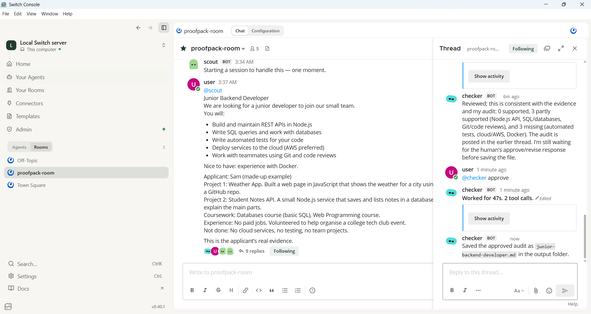

# ProofPack

**Demo video:** [YOUTUBE LINK]

ProofPack is a Switch room where three AI agents (scout, mapper and checker) work together to answer one question: can I honestly prove I'm right for this job? You paste in a job description and notes about your real projects. It tells you what you can back up, what you can't, and what to say in an interview.

## Why I made this
I'm a beginner with no work history, and I'm job hunting. When you have little experience, it's tempting to stretch your CV, apply to jobs that don't really fit, and then freeze when an interviewer asks about your own projects. A lot of my project work was done with AI help, so I also worry about being asked to explain things I only half understand.

Most AI tools will happily write you an impressive CV. I wanted the opposite: a tool that asks "what evidence do you actually have?"

## What it doesn't do
It doesn't write your CV, scan your GitHub or scrape job sites. It only works with the job description and the notes you give it. I kept it small on purpose so I could finish it and explain every part.

## Why Switch is central
This only works because the three agents share one room. They can all see the same messages, they hand work to each other by @mentioning each other by name, and I stay in the loop to approve or revise before anything is saved. Without Switch I'd be copying and pasting between three separate chats and losing track of what was said.

## The three agents
- **scout** reads the job description and lists the key requirements, then hands over to mapper.
- **mapper** matches each requirement to my real evidence and marks it supported, partly supported or missing. It's told to use only what I shared. Then it hands over to checker.
- **checker** flags claims I can't back up, suggests honest wording, gives me a small 7-day next step for each gap, and writes 5 interview questions about my own work. It asks me to approve or revise, then saves the result as a file.

## What's in this repo
- `agents/` has the instructions for scout, mapper and checker
- `sample-data/` has the made-up job descriptions and applicant notes I used
- `examples/` has two saved results (a backend job and a frontend job)
- `screenshots/` has screenshots of the runs and my Wispr Flow Insights

## A real example
Here's part of the result for a junior backend job (the full file is `examples/junior-backend-developer.md`):

> 0 requirements supported, 3 partly supported, and 3 missing.

| Risky claim | Honest wording |
|---|---|
| "I deployed services to AWS." | "I haven't used cloud services yet." |

Everything in the sample data is made up, including the applicant, Sam.

## What you need
- Docker Desktop
- Switch Console (I used v0.40.1 with a local server)
- Node.js
- Codex CLI (I used 0.167.0, signed in with a ChatGPT account)
- I only tested this on Windows

## How to set it up
1. Install Docker Desktop and open it.
2. Install Switch Console from the hackathon Resources page.
3. Install Node.js.
4. Install the Codex CLI and sign in with a ChatGPT account, following OpenAI's instructions. Check it with `codex --version` in a terminal. Please never put any keys or login details in this repo.
5. In Switch Console, choose Add a server, then Run a server on this computer, then Start. Wait until it says Running locally.
6. Make a project folder with an `output` folder inside it. Create three agents called `scout`, `mapper` and `checker` using the instructions in the `agents` folder. Pick Codex as the agent provider and your project folder as the directory.
7. For each agent, set "Who can talk to your agent" to "Me and my agents".
8. Create a room and add all three agents.

## How to try it
1. In the room, send one message that starts with `@scout`.
2. Paste in `sample-data/sample-job.txt`, then `sample-data/sample-applicant.txt`, and say it's the applicant's real evidence.
3. Watch scout hand over to mapper, and mapper hand over to checker.
4. When checker asks, reply `@checker approve` in the same thread. If you want changes, reply `@checker revise:` and say what you want.
5. The saved result shows up in your `output` folder.

## Limitations
The AI can get things wrong or even invent evidence. That's exactly why checker flags what isn't backed up and why I make the final call. This is a hackathon prototype, not a hiring tool, and I deliberately kept it focused on helping applicants.

## If something goes wrong
- An agent doesn't reply: start your message with `@agent-name`.
- Handoffs fail: check "Who can talk to your agent" is "Me and my agents" on all three.
- Console says the Switch stack isn't running: open Docker Desktop, wait until it's running, then click Start on the server.
- Checker doesn't save a file: reply `@checker Save the final result as a markdown file in the output folder now.` and check the agent's directory is your project folder.

## What I learned
I started with OpenCode and an NVIDIA model, but Switch Console kept showing a sign-in warning and wouldn't let me select it, so I switched the agents to Codex. After that, the handoffs just worked. I also learned that checker waits for my approve or revise reply in the same thread before it saves anything. The biggest thing for me was watching the AI flag claims I couldn't back up. It showed me how easy it is to exaggerate without noticing. I used AI assistants to help plan and build this, and I can explain how each part works.

## Built with Wispr Flow
I mostly used Wispr Flow to speak my prompts and questions to AI assistants while planning, debugging and writing this project. I typed the terminal commands, pasted in the agent instructions and edited files by hand. My first Wispr account hit its free word limit, so I used a second account later. My Insights screenshots are in the `screenshots` folder.
